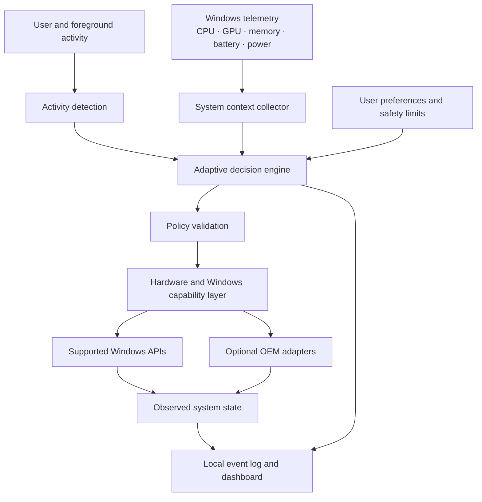
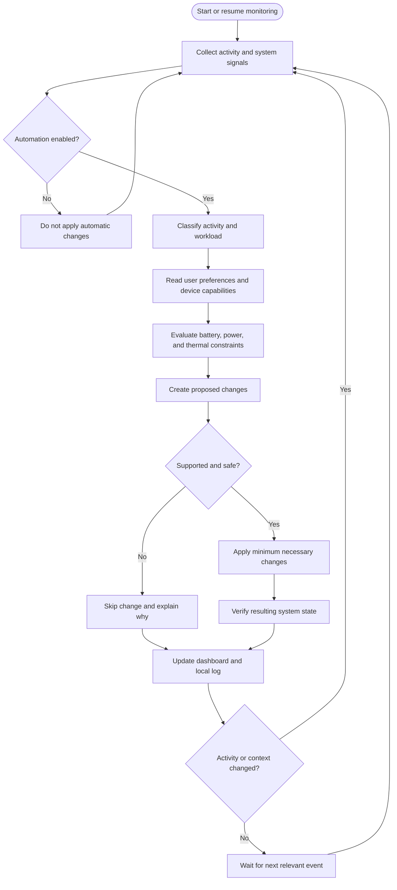
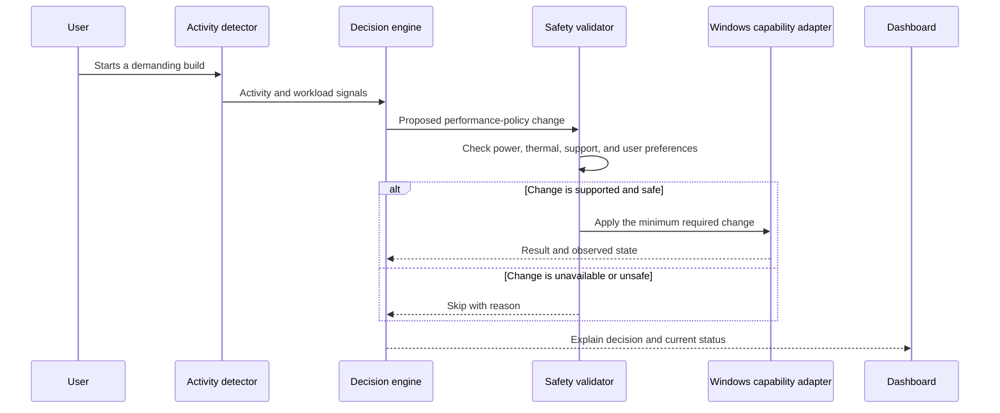

# Adaptive Computing & Resource Optimization Utility

> **An open-source, activity-aware Windows utility that helps a laptop adapt its performance, power use, and display behavior to the work being done.**

<!-- Replace these placeholders after publishing the repository. -->
<!--  -->
<!--  -->

## Project at a glance

Windows laptops are used for very different tasks: reading, browsing, video playback, software development, gaming, and AI/ML workloads. Those tasks do not need the same balance of compute performance, energy use, display behavior, and background activity.

This project explores a **context-aware optimization layer** that observes application activity and system conditions, determines which adjustments are appropriate, and applies only supported, safe, user-approved changes. The goal is to reduce repetitive manual configuration while keeping users informed and in control.

> **Current scope:** This repository describes the project direction and proposed architecture. It is not yet a claim that every optimization or hardware integration is implemented. Supported capabilities will be documented and tested as they become available.

## Dashboard concept

The following image is a design concept, not a screenshot of a working application. The intended interface is deliberately minimal: one automation control, a clear current status, and a compact view of system health.

## Why this project?

Most laptops expose a collection of power, display, and performance settings. Some manufacturers also provide their own control applications. These tools are useful, but capabilities and automation differ between devices, and users may still need to change settings manually as their activities change.

This project aims to investigate a unified, extensible approach:

- Understand **activity and workload**, not just the name of the foreground application.
- Consider battery state, power source, resource pressure, and thermal constraints before acting.
- Coordinate available Windows controls through one decision engine.
- Explain what changed and why.
- Preserve user choice through automation controls, preferences, and manual override.
- Degrade gracefully when a laptop does not expose a particular hardware capability.

## Example activity scenarios

| Activity or workload | Possible response (subject to device support and user settings) |
|---|---|
| Reading PDFs or documentation | Apply a preferred brightness or display profile; reduce avoidable background activity. |
| Video streaming | Favor efficient playback and decoding; avoid requesting unnecessary high-performance settings. |
| Social media and short-form video | Maintain smooth playback while using an appropriate power policy and preferred display settings. |
| Coding and editing | Keep the development environment responsive without forcing maximum performance while idle. |
| Compilation, builds, and debugging | Detect sustained workload and request a suitable performance policy when power and thermal conditions allow. |
| AI/ML training or local inference | Observe CPU, GPU, memory pressure, power, and thermal signals; avoid unsafe or unsupported tuning. |
| Gaming | Detect supported game workloads and request an appropriate performance configuration. |
| Idle or light browsing | Prefer efficient settings when doing so does not harm responsiveness. |

These are **intended behaviors**, not guaranteed outcomes. For example, Windows and the hardware driver remain responsible for scheduling CPU and GPU work. The utility will request supported policy changes rather than replace the operating-system scheduler or claim arbitrary control over physical memory.

## Goals

1. **Activity-aware decisions** — combine foreground application signals with process and workload telemetry.
2. **Resource-conscious behavior** — consider CPU, GPU, memory pressure, battery, power source, and thermal information.
3. **Adaptive power policy** — use documented Windows power-management interfaces where available.
4. **Display adaptation** — offer user-configurable brightness and display preferences on supported hardware.
5. **Safe background management** — identify avoidable background work; never terminate critical processes or silently interfere with user work.
6. **Transparency** — show the current decision, the reason for it, and the setting that was changed.
7. **User control** — provide a master enable/disable switch, manual override, per-activity preferences, and restoration behavior.
8. **Offline-first operation** — keep core monitoring, decision-making, and configuration local.
9. **Extensibility** — separate universal Windows capabilities from optional manufacturer-specific integrations.

## Non-goals and safety boundaries

- Replacing Windows power management, CPU scheduling, GPU scheduling, or memory management.
- Promising identical fan, thermal, GPU, or turbo controls on every laptop.
- Forcing performance settings when battery, temperature, firmware, or device policy makes them unsuitable.
- Killing user applications or system processes to create the appearance of a “RAM cleaner.”
- Collecting browsing content, keystrokes, documents, or personal activity data.
- Requiring cloud AI for core functionality.

## Proposed architecture

The system is planned as a small Windows desktop application paired with a background service. The service gathers signals and evaluates policy; a capability layer applies only supported changes.

### Main components

| Component | Responsibility |
|---|---|
| Desktop UI | Status, preferences, automation toggle, explanations, and manual override. |
| Background service | Runs monitoring and policy evaluation without requiring the dashboard to remain open. |
| Activity detector | Combines foreground-window identity, process metadata, and workload signals. |
| Context collector | Reads supported CPU, GPU, memory, battery, power-source, and thermal information. |
| Decision engine | Selects a proposed optimization based on activity, system state, user preferences, and safety limits. |
| Policy validator | Rejects unsupported, conflicting, unsafe, or unnecessary changes. |
| Capability layer | Exposes a common interface over Windows APIs and optional OEM-specific adapters. |
| State and audit store | Records settings changed by the utility, decisions, and restoration information locally. |

## Decision workflow

## Example: activity-aware policy flow

## Technology direction

The initial implementation is planned around native Windows development:

| Area | Proposed technology |
|---|---|
| Primary language | C# |
| Runtime | .NET |
| Desktop UI | WinUI 3 |
| Background worker | .NET Worker Service / Windows Service, subject to permission and lifecycle design |
| OS integration | Documented Windows APIs and carefully scoped P/Invoke |
| Telemetry | Windows performance counters, ETW, and supported hardware interfaces |
| Local settings and history | SQLite and JSON |
| Testing | xUnit or NUnit; integration tests on supported Windows versions |
| CI | GitHub Actions |
| Optional local ML | ONNX Runtime, only if measurable value is demonstrated |

The exact minimum Windows version and .NET target will be selected during the first implementation milestone and recorded in the compatibility matrix.

## Compatibility strategy

A universal core will use documented Windows interfaces. Optional adapters may add capabilities for particular vendors or hardware families.

| Capability | Compatibility approach |
|---|---|
| Foreground application and process detection | Windows APIs |
| CPU and memory telemetry | Windows performance interfaces |
| Battery and power-source status | Windows power APIs |
| Power policy changes | Supported Windows power-management interfaces |
| Display brightness and configuration | Supported display APIs; device-dependent |
| GPU telemetry and per-app preference | Driver- and hardware-dependent interfaces |
| Fan curves, turbo modes, and OEM thermal profiles | Optional vendor-specific integrations only |

The application must detect capabilities at runtime and clearly indicate when a setting is unavailable. It must not imply that administrator permission alone unlocks firmware-controlled features.

## Privacy and security

- Core functionality is designed to run locally and offline.
- Collect only the system signals required for optimization.
- Do not inspect document contents, browser history, keystrokes, or message contents.
- Store configuration and diagnostic history locally.
- Make logging configurable and provide a way to clear local history.
- Request elevated permissions only for operations that genuinely require them.
- Validate every change and preserve enough state to restore settings changed by the utility.
- Never disable security software, Windows Update, or critical system services as an optimization shortcut.

## Development roadmap

The project is currently in the planning / early-development stage. Milestones will be updated as code, tests, and verified hardware support are added.

- [ ] **Milestone 0 — Repository foundation:** license, contribution guide, coding standards, CI, issue templates, and architecture decisions.
- [ ] **Milestone 1 — Read-only monitor:** detect foreground applications and display CPU, memory, battery, and power-source information.
- [ ] **Milestone 2 — Activity rules:** implement configurable, explainable activity and workload classification.
- [ ] **Milestone 3 — Safe power policy:** apply and restore a limited set of documented Windows power settings.
- [ ] **Milestone 4 — Display preferences:** add supported brightness and display adjustments with user controls.
- [ ] **Milestone 5 — Background workload insights:** identify resource-heavy processes and offer safe recommendations.
- [ ] **Milestone 6 — Hardware adapters:** add and test optional vendor-specific capabilities.
- [ ] **Milestone 7 — Personalization:** evaluate local learning only after reliable baseline rules and benchmarks exist.
- [ ] **Milestone 8 — Public beta:** compatibility matrix, installer, documentation, security review, and reproducible benchmarks.

## Measuring success

Optimization claims will be supported by repeatable tests rather than assumptions. Planned measurements include:

- CPU/GPU utilization and memory pressure during defined workloads.
- Energy use or battery discharge rate under controlled, repeatable conditions.
- Application responsiveness and build/render completion time.
- Time taken to detect an activity and apply a policy.
- Correct restoration after an application closes or automation is disabled.
- False activity detections, unnecessary policy changes, and unsupported-capability handling.

Benchmarks should record laptop model, CPU/GPU, RAM, Windows build, power source, workload, ambient conditions where relevant, and test duration. Results from one device must not be presented as universal.

## Contributing

Contributions are welcome, especially in Windows API research, telemetry, activity detection, hardware compatibility, testing, documentation, and accessibility.

Before contributing:

1. Open an issue to discuss substantial changes.
2. Keep hardware-specific behavior behind capability interfaces.
3. Include tests for decision logic and restoration behavior.
4. Document Windows versions and hardware used for integration tests.
5. Never add a system-changing feature without a safe fallback and clear user control.

Please read [`CONTRIBUTING.md`](CONTRIBUTING.md) before opening a pull request. A Code of Conduct and security reporting process should be added before inviting broad community participation.

## How Codex and development tools may support the project

AI coding tools, including Codex, may be used as development assistants for:

- Exploring Windows API documentation and generating implementation scaffolding.
- Drafting unit and integration tests for decision logic.
- Reviewing pull requests and identifying regressions.
- Maintaining documentation and compatibility notes.
- Automating issue triage, release notes, and CI workflows.

Generated code must be reviewed, tested on real Windows systems, and checked against official API documentation. System-level changes require particular care; automated suggestions must never bypass safety review.

## Project status and transparency

This is an early-stage open-source project. The architecture, scenarios, and roadmap describe intended direction. A feature should be marked supported only after implementation, automated testing where practical, and verification on documented hardware.

The repository should maintain:
- A public issue tracker and discussion process.
- A changelog for user-visible changes.
- A compatibility matrix based on actual tests.
- Reproducible benchmarks for optimization claims.
- Clear labels for planned, experimental, and stable features.

## License

**License: To be selected before public release.**

Choose an OSI-approved license and add its full text as `LICENSE`. Do not describe the project as open source until the license is present.

## Acknowledgements

This project builds on the Windows platform and the work of open-source developers maintaining .NET, WinUI tooling, testing frameworks, and system-monitoring libraries. Specific dependencies and their licenses will be listed as they are selected.

---

**Project principle:** Observe first. Decide transparently. Change only what is supported and safe. Restore when the context changes.
